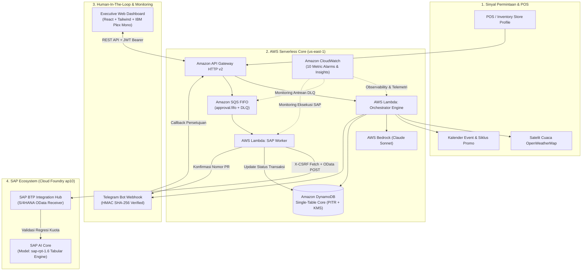

# AutoReplenish.ai

<p align="center">
  <strong>Autonomous Contextual Inventory Replenishment & Supply Chain Middleware</strong><br>
  Enterprise-grade agentic replenishment integrating <strong>AWS Bedrock (Claude Sonnet 3.7 / 4.5)</strong>, <strong>SAP S/4HANA OData</strong>, <strong>SAP AI Core</strong>, and <strong>Event-Driven Serverless Infrastructure</strong>.
</p>

<p align="center">
  
  
  
  
  
  
  
</p>

---

## 📋 Ikhtisar Produk (Product Overview)

**AutoReplenish.ai** adalah platform *Agentic Middleware* terdistribusi yang mengotomatisasi pengadaan inventaris ritel dan FMCG secara cerdas dan kontekstual. Sistem ini menggantikan formula statis tradisional (*Min-Max* atau *Simple Moving Average*) dengan **Cognitive Demand Reasoning Engine** yang memproses sinyal multi-dimensi secara simultan:

* **Sinyal Kontekstual Eksternal**: Korelasi curah hujan dan suhu real-time via satelit OpenWeatherMap GPS, siklus hari gajian (*payday*), akhir pekan, serta kalender event promo lokal.
* **Karakteristik & Risiko SKU**: Masa simpan barang mudah basi (*shelf-life* komoditas *perishable*), laju konsumsi harian (*burn rate*), dan *supplier lead time*.
* **Batasan Logistik Pemasok**: Pemenuhan ketat terhadap *Minimum Order Quantity* (MOQ) dan kelipatan kemasan karton (*packaging multiple*).
* **Tata Kelola Human-in-the-Loop (HITL)**: Persetujuan delegatif satu klik oleh Kepala Toko melalui Telegram Bot sebelum pemesanan diajukan ke ERP.
* **Integrasi ERP Kelas Enterprise**: Penerbitan dokumen *Purchase Requisition* otomatis ke **SAP S/4HANA** melalui protokol OData v2 terotentikasi, disertai validasi kewajaran kuota oleh model tabular **SAP AI Core (`sap-rpt-1.6`)**.

---

## 🏛️ Arsitektur Sistem Terdistribusi

Sistem dibangun di atas prinsip arsitektur *event-driven*, *zero-loss queueing*, dan *fail-safe deterministic fallback*.



---

## ⚡ Fitur Utama & Keunggulan Rekayasa

### 1. Zero-Loss Asynchronous Approval Architecture
Persetujuan dari Kepala Toko diproses secara asinkron menggunakan **Amazon SQS FIFO** dengan *Message Deduplication ID* berbasis hash transaksi. Hal ini memastikan webhook Telegram merespons instan (< 200 ms) tanpa membebani proses I/O ke SAP, sekaligus mencegah *lost updates* atau *out-of-order execution*.

### 2. Idempotency & Double-Submit Protection
Mekanisme penguncian mutlak menggunakan *DynamoDB Conditional Writes* (`attribute_exists(PK) AND #status IN (:pending, :edit)`). Tombol persetujuan yang ditekan berulang kali atau pesan duplikat dari jaringan seluler secara otomatis ditolak tanpa menimbulkan duplikasi *Purchase Requisition*.

### 3. Fail-Safe Deterministic Fallback Engine
Apabila terjadi gangguan jaringan eksternal, latensi tinggi, atau batasan kuota AI, orkestrator secara transparan beralih ke mesin deterministik berbasis aturan stok pengaman (*Safety Stock Formula*). Status transisi dicatat dengan flag `DETERMINISTIC_FALLBACK` sehingga operasional toko fisik tetap berjalan 100% tanpa henti (*zero operational downtime*).

### 4. Validasi Model Tabular SAP AI Core (`sap-rpt-1.6`)
Setiap dokumen yang masuk ke endpoint OData SAP BTP dikirimkan ke model regresi tabular `sap-rpt-1.6` di SAP AI Core untuk memverifikasi apakah rekomendasi kuota berada dalam rentang kewajaran historis pengadaan material tersebut.

### 5. Enterprise Observability & Audit Trail
Seluruh keputusan algoritmik merekam jejak audit lengkap: versi *prompt*, parameter suhu cuaca, baseline deterministik, respon model AI, identitas manajer penyetuju, dan nomor dokumen SAP. Dasbor analitik menyajikan metrik kepatuhan manajer, deviasi WAPE (*Weighted Absolute Percentage Error*), serta latensi sistem secara real-time.

---

## 📂 Struktur Repositori

```text
autoreplenish.ai/
├── backend/                        # Layanan Backend Python 3.12 (AWS Lambda & FastAPI)
│   ├── lambda_handlers.py          # Entrypoints Lambda: Orchestrator, Webhook, API, Worker
│   ├── main.py                     # Router FastAPI: Auth JWT, Health, Store & SKU CRUD, Metrik
│   ├── requirements-lambda.txt     # Dependensi kompilasi ramping untuk runtime Lambda
│   └── src/
│       ├── auth.py                 # Keamanan JWT Bearer & verifikasi password bcrypt
│       ├── config.py               # Integrasi konfigurasi runtime & AWS Secrets Manager
│       ├── models/schema.py        # Kontrak data Pydantic (StoreProfile, SKUItem, AuditLog)
│       └── services/               # Modul layanan (Bedrock, DynamoDB, SQS, SAP, Telegram, Weather)
├── dashboard/                      # Web Dashboard Frontend (React 18 + Vite + Tailwind CSS)
│   ├── src/
│   │   ├── App.jsx                 # UI Utama: Monitoring, 5-Tab Store Settings, Audit Trail
│   │   ├── api.js                  # Klien HTTP Axios dengan interceptor token terotentikasi
│   │   └── index.css               # Claude Dark Mode Design System & IBM Plex Mono typography
│   ├── index.html                  # HTML Shell dengan Google Fonts IBM Plex Mono
│   └── vite.config.js              # Konfigurasi server Vite & reverse-proxy Gateway
├── infra/terraform/                # AWS Infrastructure-as-Code (Terraform v1.8+)
│   ├── api_gateway.tf              # HTTP API Gateway v2, routing, CORS, dan stage log
│   ├── dynamodb.tf                 # Tabel DynamoDB Single-Table (GSI, KMS, Point-in-Time Recovery)
│   ├── eventbridge.tf              # Scheduler siklus otomatisasi (03:00 WIB & 14:00 WIB)
│   ├── iam.tf                      # Kebijakan IAM Least-Privilege untuk tiap fungsi Lambda
│   ├── lambda.tf                   # Definisi 4 fungsi AWS Lambda (memory, timeout, env vars)
│   ├── sqs.tf                      # Antrean SQS FIFO approval dan Dead-Letter Queue (DLQ)
│   ├── alarms.tf                   # 10 CloudWatch Metric Alarms (DLQ, latency, error, fallback)
│   └── production.tfvars.example   # Template variabel Terraform lingkungan produksi
├── sap-btp-service/                # Microservice SAP BTP Cloud Foundry (Python Flask + Gunicorn)
│   ├── app.py                      # Endpoint OData S/4HANA Receiver & SAP AI Core Bridge
│   ├── manifest.yml.example        # Template manifest Cloud Foundry deployment
│   ├── requirements.txt            # Dependensi Flask, Gunicorn, Requests
│   └── runtime.txt                 # Konfigurasi runtime Cloud Foundry (Python 3.12.x)
├── tests/                          # Automated Pytest Suite (Unit, Queue, Security, Idempotency)
├── PRD_Present.md                  # Dokumen Spesifikasi Produk & Panduan Presentasi Lengkap
├── PRD.md                          # Dokumen Persyaratan Produk Arsitektural Utama
├── .gitignore                      # Proteksi keamanan secret, biner, dan file lokal
└── README.md                       # Dokumentasi resmi repositori
```

---

## 🛠️ Panduan Penerapan & Operasional (Deployment Guide)

### 1. Prasyarat Sistem
* **Python**: `^3.12`
* **Node.js**: `^20.x` & npm
* **AWS CLI**: v2 (terautentikasi ke region `us-east-1` dengan izin Administrator/DevOps)
* **Terraform**: `>= 1.8.0`
* **Cloud Foundry CLI (`cf`)**: Terautentikasi ke endpoint SAP BTP
* **Docker Engine**: Digunakan untuk membuat paket binary zip AWS Lambda (Linux x86_64)

---

### 2. Konfigurasi Rahasia Lingkungan (Secrets Management)
Seluruh kredensial sensitif dikelola melalui **AWS Secrets Manager** pada secret ID `autoreplenish/production/application`:

| Kunci Rahasia | Keterangan |
| :--- | :--- |
| `JWT_SECRET_KEY` | Kunci simetris penandatanganan token JWT sesi dasbor |
| `ADMIN_USERNAME` | Username administrator web dashboard |
| `ADMIN_PASSWORD` | Password otentikasi administrator |
| `TELEGRAM_BOT_TOKEN` | Token otentikasi BotFather Telegram |
| `TELEGRAM_WEBHOOK_SECRET` | Kunci HMAC SHA-256 verifikasi header `X-Telegram-Bot-Api-Secret-Token` |
| `OPENWEATHER_API_KEY` | Kunci akses API satelit OpenWeatherMap |

---

### 3. Kompilasi & Penerapan Infrastruktur AWS (Terraform)

Jalankan perintah berikut untuk mengompilasi dependensi Lambda ke lingkungan Linux Amazon dan menerapkan infrastruktur:

```powershell
# 1. Kompilasi dependensi Lambda menggunakan kontainer Amazon Linux
docker run --rm -v "${PWD}:/var/task" public.ecr.aws/sam/build-python3.12:latest-x86_64 `
  sh -c "rm -rf /tmp/pkg && mkdir -p /tmp/pkg && \
         pip install --no-cache-dir -r backend/requirements-lambda.txt -t /tmp/pkg && \
         rm -rf /tmp/pkg/boto3* /tmp/pkg/botocore* && \
         find /tmp/pkg -type d -name '__pycache__' -exec rm -rf {} + 2>/dev/null && \
         cd /tmp/pkg && zip -r9 /var/task/build/lambda.zip . && \
         cd /var/task && zip -g -r9 build/lambda.zip backend -x 'backend/__pycache__/*'"

# 2. Inisialisasi dan terapkan infrastruktur Terraform
cd infra/terraform
terraform init
terraform plan -var-file="production.tfvars"
terraform apply -var-file="production.tfvars" -auto-approve
```

---

### 4. Penerapan Layanan SAP BTP Cloud Foundry

Deploy microservice penerima OData S/4HANA dan jembatan SAP AI Core:

```powershell
cd sap-btp-service

# Salin manifest template dan sesuaikan kredensial AI Core
Copy-Item manifest.yml.example manifest.yml

# Unggah dan jalankan aplikasi di space Cloud Foundry
cf push
```

Endpoint layanan akan aktif pada:  
`https://autoreplenish-sap-btp.cfapps.ap10.hana.ondemand.com/odata/s4hana`

---

### 5. Menjalankan Executive Web Dashboard (Frontend)

```powershell
cd dashboard

# Salin template environment
Copy-Item .env.example .env

# Pasang dependensi dan nyalakan dev server
npm install
npm run dev
```

Akses dasbor melalui antarmuka web pada **`http://localhost:5173`**.

---

## 🧪 Validasi Pengujian Otomatis (Automated Test Suite)

Repositori dilengkapi dengan rangkaian pengujian unit, integritas antrean, dan validasi keamanan:

```powershell
# Eksekusi seluruh rangkaian pengujian dari direktori root
python -m pytest tests/ -v
```

Cakupan pengujian meliputi:
* `test_orchestrator.py`: Pengujian logika penimbangan cuaca, lead-time, dan kalkulasi baseline.
* `test_queue_worker.py`: Verifikasi alur antrean SQS FIFO, retry policy, dan penanganan DLQ.
* `test_security.py`: Verifikasi validasi signature webhook Telegram (HMAC) dan sanitasi input.
* `test_idempotency.py`: Validasi pencegahan approval ganda melalui conditional lock database.

---

## 📊 Metrik Kepatuhan & Observability Produksi

Platform memantau kesehatan operasional secara berkelanjutan melalui 10 **Amazon CloudWatch Metric Alarms**:

| Nama Alarm CloudWatch | Threshold / Kondisi Pemicu | Tingkat Keparahan | Tindakan Remediasi |
| :--- | :--- | :--- | :--- |
| `approval-dlq-not-empty` | Jumlah pesan pada antrean DLQ `> 0` | **CRITICAL** | Notifikasi teknisi on-call; pesan tersimpan aman di DLQ untuk replay |
| `approval-queue-age` | Usia pesan tertua dalam antrean `> 900s` | **WARNING** | Peningkatan kapasitas konkurensi Lambda SAP Worker |
| `bedrock-fallback-rate` | Deteksi fallback deterministik `> 3 event` | **WARNING** | Evaluasi kuota token Bedrock dan status regional model |
| `sap-integration-failure` | Kegagalan OData HTTP 5xx `> 2 event` | **CRITICAL** | Pengecekan konektivitas SAP BTP Destination / token OAuth |
| `orchestrator-error-rate` | Error eksekusi orkestrasi `> 0` | **HIGH** | Analisis log CloudWatch Insights untuk identifikasi anomali input |

---

## 🔒 Kebijakan Keamanan & Kepatuhan Enterprise

1. **Zero Secret in Source Control**: Tidak ada token, kunci privat, atau password yang disimpan di dalam repositori kode. Seluruh konfigurasi sensitif disuntikkan secara dinamis melalui AWS Secrets Manager pada saat runtime.
2. **Prinsip Least-Privilege IAM**: Setiap fungsi Lambda diisolasi ke dalam IAM Role mandiri. Tidak ada fungsi yang memiliki izin wildcard (`*`) pada tabel database atau antrean pesan.
3. **Enkripsi Data End-to-End**: Seluruh komunikasi data dalam transit dilindungi protokol **TLS 1.3 / HTTPS**. Data saat istirahat (*at-rest*) di DynamoDB dienkripsi menggunakan kunci **AWS KMS (KMS CMK)** dengan cadangan berkesinambungan (*Point-In-Time Recovery / PITR*).
4. **Verifikasi Tanda Tangan Webhook**: Setiap update callback dari Telegram divalidasi menggunakan token rahasia webhook (`X-Telegram-Bot-Api-Secret-Token`) guna menangkal serangan *Spoofing* dan *Replay Attack*.

---

## 📄 Lisensi

Didistribusikan di bawah lisensi **Apache License 2.0**. Lihat berkas `LICENSE` untuk informasi selengkapnya.
