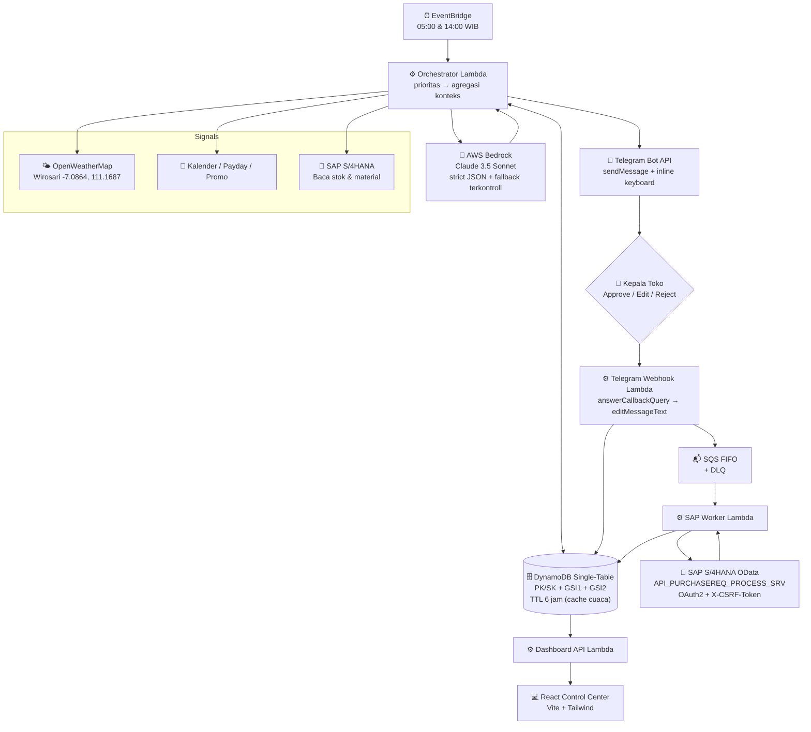

<div align="center">

# 📦 AutoReplenish.ai

### **Agentic AI for Minimarket Multi-Store Replenishment & Supply Chain Optimization**

*Mitigating Stockouts & Overstock with Context-Aware AI Reasoning, Human-in-the-Loop Telegram Interaction, and SAP S/4HANA Integration.*

[](#)
[](#)
[](#)
[](#)
[](#)
[](#)

</div>

---

## 🌟 Ringkasan Eksekutif

**AutoReplenish.ai** adalah platform orkestrasi rantai pasok cerdas (*Agentic AI*) berbasis *Human-in-the-Loop* untuk jaringan minimarket. Sistem menggantikan proses *restocking* manual yang lambat dan rentan bias dengan analisis prediktif multi-variabel otomatis.

Menggunakan **Claude 3.5 Sonnet via AWS Bedrock**, sistem mengevaluasi dinamika stok, cuaca lokal, kalender belanja, dan batasan operasional supplier (MOQ, kelipatan kemasan, *shelf life*) sebelum mengajukan rekomendasi pemesanan ke aplikasi Telegram Kepala Toko. Setelah disetujui, *Purchase Requisition* diterbitkan ke **SAP S/4HANA** melalui OData.

**Pilot gerai:** Toko Almadina Sembako — W36X+286, Beru Kulon, Kalirejo, Kec. Wirosari, Grobogan, Jawa Tengah 58192.

---

## 🏗️ Arsitektur Sistem (AWS)



### Komponen utama

| Komponen | Implementasi | Berkas |
| :--- | :--- | :--- |
| **Orchestration & Trigger** | EventBridge → Lambda (boto3 SDK riil) | `infra/eventbridge.tf`, `backend/src/handlers/scheduled_eval_handler.py` |
| **Reasoning Engine** | Bedrock `invoke_model` (Claude 3.5 Sonnet), 2x retry, fallback deterministik ber-flag `is_fallback` | `backend/src/services/bedrock_service.py` |
| **System of Record (tulis)** | SAP OData deep-insert, OAuth2 + CSRF, **LIVE & PERSISTENT_SANDBOX dual-mode** | `backend/src/services/sap_service.py` |
| **State & Caching** | DynamoDB single-table (PK/SK + GSI1 + GSI2), boto3 resource | `backend/src/services/dynamodb_service.py` |
| **External Signal** | OpenWeatherMap HTTP GET, cache 3 jam valid / TTL 6 jam, degradasi stale→unavailable | `backend/src/services/weather_service.py` |
| **Human Interface** | Telegram Bot API: `sendMessage`, `answerCallbackQuery`, `editMessageText` | `backend/src/services/telegram_service.py`, `backend/src/handlers/telegram_webhook_handler.py` |
| **Monitoring UI** | React dashboard, tanpa fallback data palsu | `dashboard/src/` |

---

## 📁 Struktur Direktori

```text
AutoReplenish.ai/
├── backend/                          # Source code produksi (AWS Lambda)
│   ├── requirements.txt              # DEPENDENSI RUNTIME (di-vendor ke ZIP Lambda)
│   ├── requirements-dev.txt          # Dependensi uji (TIDAK masuk ZIP)
│   ├── build/                        # [dihasilkan] root paket deployment Lambda
│   └── src/
│       ├── config.py                 # Env vars & konstanta operasional
│       ├── models/schema.py          # Dataclass + atribut GSI untuk single-table
│       ├── handlers/                 # Lambda entry points (4 fungsi)
│       │   ├── scheduled_eval_handler.py     # EventBridge → orkestrasi
│       │   ├── telegram_webhook_handler.py   # Callback HITL + SQS dispatch
│       │   ├── sap_worker_handler.py         # Konsumer SQS → PR SAP
│       │   └── dashboard_api_handler.py      # REST read-only (API Gateway)
│       └── services/
│           ├── bedrock_service.py    # Bedrock invoke_model + fallback
│           ├── sap_service.py        # Dual-mode LIVE / PERSISTENT_SANDBOX
│           ├── dynamodb_service.py   # CRUD boto3 + akses GSI + counter atomik
│           ├── weather_service.py    # OpenWeatherMap + cache TTL
│           ├── telegram_service.py   # Bot API riil
│           ├── secrets_service.py    # Secrets Manager (cache per container)
│           ├── orchestrator_service.py
│           ├── calendar_promo_service.py
│           └── moq_packaging_service.py
│
├── dashboard/                        # React Control Center (Vite + Tailwind)
│   └── src/services/api.js           # Konektor REST (tanpa data palsu)
│
├── demo/                             # Demo lokal 100% offline (murni presentasi)
│   └── services/  mock_bedrock / mock_sap / mock_weather / local_db (SQLite) / telegram_bot (REAL)
│
├── infra/                            # Terraform (4 Lambda, DynamoDB, SQS, IAM, Secrets)
├── tests/                            # 118 unit/e2e tests (moto-emulated AWS)
├── build.sh / Makefile               # Paket deployment Lambda
└── PRD.md                            # Product Requirements Document v1.0
```

---

## 🚀 Menyiapkan & Menjalankan

### 1. Konfigurasi kredensial

Semua kredensial disimpan di **AWS Secrets Manager**, dibuat oleh Terraform dari variabel `sensitive` (tidak ada rahasia yang di-*commit*). Buat berkas `infra/secrets.auto.tfvars` (sudah di-*gitignore*):

```hcl
openweathermap_api_key = "kunci-openweathermap-anda"
telegram_bot_token      = "token-dari-botfather"
telegram_chat_id        = "chat-id-manager-toko"
telegram_webhook_secret = "string-acak-panjang"
telegram_webhook_url    = ""   # diisi setelah API Gateway dibuat

# Kosongkan SAP agar sistem berjalan dalam mode PERSISTENT_SANDBOX.
sap_client_id     = ""
sap_client_secret = ""
sap_token_url     = ""
sap_odata_base_url = ""
```

> **Catatan Bedrock:** aktifkan akses model `anthropic.claude-3-5-sonnet-20241022-v2:0` di
> Bedrock Console → *Model access* (region `ap-southeast-1`).

### 2. Paket deployment & deploy

```bash
make check-env     # verifikasi python/bash/terraform
make build         # backend/build → root ZIP Lambda (src + dependensi)
make test          # 118 unit & e2e tests (moto, tanpa akun AWS)

cd infra && terraform init
terraform plan  -var-file=secrets.auto.tfvars
terraform apply -var-file=secrets.auto.tfvars
```

### 3. Registrasi webhook Telegram

```bash
API=$(terraform -chdir=infra output -raw api_gateway_endpoint)
curl -X POST "https://api.telegram.org/bot<TOKEN>/setWebhook" \
  -H "Content-Type: application/json" \
  -d "{\"url\": \"${API}webhook/telegram\", \"secret_token\": \"<WEBHOOK_SECRET>\"}"
```

### 4. Jalankan Dashboard

```bash
cd dashboard
npm install
# Untuk demo lokal: jalankan demo/scripts/05_dashboard_api.py (port 8000)
# Untuk AWS: set VITE_API_BASE_URL ke URL API Gateway pada dashboard/.env
npm run dev
```

---

## 🧠 Matriks Bobot Penalaran Multi-Variabel

Agen AI (Claude 3.5 Sonnet) menalar terhadap:

| Bobot | Variabel |
| :--- | :--- |
| 35–40% | Stok fisik vs threshold & histori *burn rate* |
| 20–25% | Jadwal supplier & *lead time* |
| 15–20% | Katalog promo internal |
| 10–15% | Cuaca & suhu (OpenWeatherMap) |
| 5–10% | Kalender, payday, hari libur, demografi wilayah |
| Batasan fisik | MOQ, kelipatan kemasan, **shelf life**, kerapuhan barang |

### Guardrail penalaran

- **Strict JSON**: output tervalidasi terhadap skema; markdown fence dibersihkan.
- **2x retry** jika JSON ditolak atau terjadi `ThrottlingException`.
- **Fallback deterministik** hanya aktif jika semua percobaan Bedrock gagal, dan **selalu** menandai `is_fallback: true` — ditampilkan juga pada kartu Telegram dan audit trail, sehingga angka turunan aturan internal tidak pernah disamarkan sebagai output model.

---

## 📦 Katalog Pilot — Toko Almadina Sembako

| SKU | Nama | Kategori | MOQ | Kemasan | Satuan | Shelf Life | Lead Time |
| :--- | :--- | :--- | ---: | ---: | :--- | ---: | ---: |
| SKU-ALM-001 | Beras Medium Premium 5kg | Non-Perishable | 5 karung | 5 | KARUNG | 365h | 3h |
| SKU-ALM-002 | Minyak Goreng Sawit 1L | Non-Perishable | 12 pouch (1 kardus) | 12 | POUCH | 270h | 2h |
| SKU-ALM-003 | Telur Ayam Ras Segar 1kg | Perishable, **rapuh** | 10 | 10 | KG | 14h | **1h** |
| SKU-ALM-004 | Roti Basah Tradisional / Kue Pangan 100g | Perishable, **rapuh** | 12 | 12 | PCS | **3h** | 1h |
| SKU-ALM-005 | Gula Pasir Kristal Putih 1kg | Non-Perishable | 20 pcs (1 sak) | 20 | PCS | 730h | 2h |

Katalog ini hanya di-*seed* ketika koleksi DynamoDB masih kosong, sehingga master data produksi dapat ditimpa dari SAP.

---

## 🔒 Integrasi SAP — Dual Mode

| Mode | Kondisi | Perilaku |
| :--- | :--- | :--- |
| **LIVE** | Secret SAP berisi `client_id`, `client_secret`, `odata_base_url` | OAuth2 client-credentials → `X-CSRF-Token: Fetch` → POST deep-insert ke `API_PURCHASEREQ_PROCESS_SRV` (timeout 5s, backoff eksponensial, 4xx tidak di-retry) |
| **PERSISTENT_SANDBOX** | Kredensial kosong | Respons OData `{"d": {...}}` persis bentuknya SAP, nomor PR dari counter atomik DynamoDB, **ledger transaksi persisten di DynamoDB** |

Kedua mode memakai kontrak idempotency yang sama: ledger diperiksa sebelum mutasi sehingga tombol yang di-klik dua Kali atau pesan SQS yang di-retry tidak mungkin membuat PR ganda.

---

## 🛡️ Keamanan & Kepatuhan

- **Tidak ada rahasia di repositori.** Kredensial OWM/Telegram/SAP berasal dari Secrets Manager; Terraform memakai variabel `sensitive` tanpa nilai default.
- **Webhook Telegram** divalidasi melalui header `X-Telegram-Bot-Api-Secret-Token`.
- **IAM least-privilege**: satu role per Lambda; Dashboard API hanya diberi `dynamodb:GetItem`, `Query`, `kms:Decrypt`.
- **DynamoDB**: enkripsi KMS, PITR, TTL 6 jam pada cache cuaca.
- **SQS FIFO** dengan `MessageDeduplicationId = request_id` + redrive ke DLQ (3 percobaan).
- **Dashboard tidak pernah menampilkan data yang dikarang.** Jika backend tidak dapat dijangkau, banner degradasi tampil eksplisit.

---

## 🧪 Pengujian

```bash
make test
```

118 *tests* berjalan sepenuhnya lokal melalui **moto** (DynamoDB/SQS/Secrets Manager diemulasi), dengan *double* hanya di batas jaringan (Bedrock, OpenWeatherMap, Telegram, SAP):

| Berkas | Cakupan |
| :--- | :--- |
| `test_dynamodb_service.py` | CRUD boto3 nyata, PK/SK, GSI1, GSI2, cache terbalik, TTL, counter atomik |
| `test_bedrock_reasoning.py` | Bentuk payload `invoke_model`, retry, fallback ber-flag, guardrail JSON |
| `test_weather_cache.py` | GET HTTP OpenWeatherMap, pemetaan field, cache hit/miss/expired, degradasi |
| `test_telegram_service.py` | `sendMessage` / `answerCallbackQuery` / `editMessageText`, kegagalan tidak melempar |
| `test_sap_integration.py` | Dual-mode, OAuth2, CSRF, idempotency lintas *cold start* |
| `test_end_to_end_flow.py` | EventBridge → Bedrock → Telegram → SAP → audit trail |
| `test_telegram_state_machine.py` | Alpercapan callback, free-text, timeout, double-click, webhook secret |
| `test_sku_prioritization.py` | 9 kriteria prioritas pada katalog almadan |
| `test_moq_packaging.py` | Pembulatan konservatif untuk perishable/rapuh |

---

## 📄 Lisensi

MIT License · Prompt AI `v1.0` · Model utama: Claude 3.5 Sonnet via AWS Bedrock
