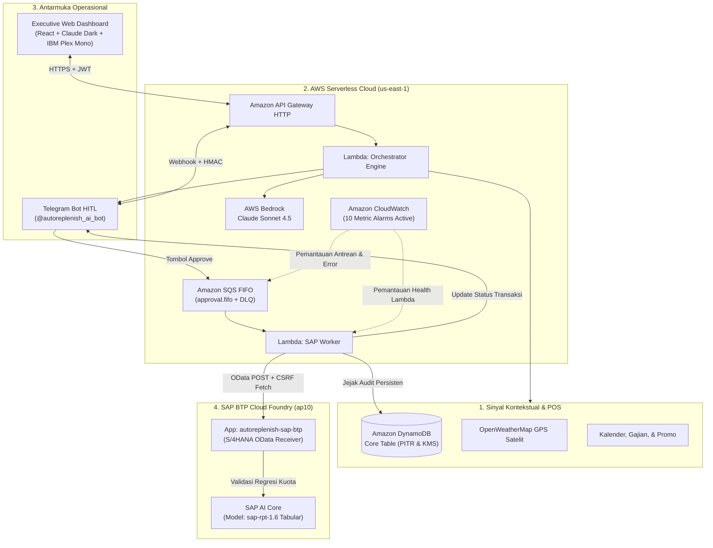

# AutoReplenish.ai 🛒⚡

> **Autonomous Contextual Inventory Replenishment Middleware for Retail & FMCG Networks**  
> Powered by **AWS Bedrock (Claude Sonnet 4.5)**, **SAP S/4HANA OData**, **SAP AI Core (`sap-rpt-1.6`)**, **Telegram Bot (HITL)**, and **AWS Serverless Cloud**.

---

## 🌟 Executive Summary

**AutoReplenish.ai** adalah solusi *Agentic AI Middleware* mutakhir yang dirancang khusus untuk memecahkan dilema klasik jaringan minimarket dan ritel: **Stockout vs Overstock Paradox**.

Alih-alih mengandalkan formula statis (*Min-Max* atau *Moving Average*) yang buta konteks, AutoReplenish.ai menalar berbagai variabel dinamis secara simultan:
1. **Sinyal Eksternal Riil**: Cuaca satelit GPS (hujan lebat / panas terik), kalender gajian, akhir pekan, dan agenda promo lokal.
2. **Karakteristik SKU**: Batas kedaluwarsa barang perishable (*shelf life*), kecepatan konsumsi harian (*burn rate*), dan lead time pengiriman gudang.
3. **Safety Guardrails**: Minimum Order Quantity (MOQ) dan kelipatan kemasan supplier (*packaging multiples*).
4. **Human-in-the-Loop (HITL)**: Persetujuan satu klik oleh Kepala Toko via Telegram Bot sebelum PO diterbitkan.
5. **Integrasi Enterprise End-to-End**: Transaksi otomatis diterbitkan ke **SAP S/4HANA OData** dan divalidasi oleh model tabular **SAP AI Core (`sap-rpt-1.6`)**.
6. **Executive Web Dashboard**: Pemantauan akurasi manajer (100 - WAPE), latensi AI, dan jejak audit audit-trail tanpa angka rekayasa (*zero hardcoded metrics*).

---

## 🏗️ Arsitektur Sistem Terintegrasi



---

## 🎯 Fitur & Nilai Tambah Utama

- **Zero-Loss Async Approval Architecture**: Approval dari Telegram tidak memblokir thread webhook, melainkan dimasukkan ke antrean berbobot **Amazon SQS FIFO** dengan penomoran sekuensial dan *Dead Letter Queue (DLQ)*.
- **Double-Submit & Idempotency Protection**: Mekanisme penguncian berbasis *DynamoDB Conditional Expressions* (`attribute_exists` & `status = PENDING_APPROVAL`) menjamin tombol approve yang diklik berkali-kali tidak akan menerbitkan Purchase Requisition ganda.
- **Deterministic Safe Fallback**: Jika layanan AI atau konektivitas luar mengalami gangguan, *deterministic rule engine* lokal secara otomatis mengambil alih perhitungan stok dengan anotasi transparan (`DETERMINISTIC_FALLBACK`) agar toko tidak pernah berhenti beroperasi.
- **SAP AI Core Model `sap-rpt-1.6` Verification**: Dokumen PR yang masuk ke SAP BTP Cloud Foundry langsung divalidasi oleh model AI tabular SAP untuk memprediksi kewajaran kuota restock terhadap riwayat historis.
- **Claude Dark Mode & IBM Plex Mono Dashboard**: Desain antarmuka profesional bertaraf *enterprise developer-tool* dengan kontras tinggi, border datar 1px (`#3D3C39`), aksen oranye tanah liat (*clay* `#D97757`), dan tipografi monospace penuh.

---

## 📁 Struktur Direktori Repositori

```text
autoreplenish.ai/
├── backend/                        # Backend Python 3.12 (AWS Lambda & FastAPI)
│   ├── lambda_handlers.py          # Entrypoints: Orchestrator, Webhook, Dashboard API, SAP Worker
│   ├── main.py                     # FastAPI routes: Auth JWT, Health, Store & SKU CRUD, Metrics
│   ├── requirements-lambda.txt     # Dependensi ramping untuk paket deployment Lambda
│   └── src/
│       ├── auth.py                 # JWT Bearer Token generator & verifier (PBKDF2/bcrypt)
│       ├── config.py               # Runtime configuration & AWS Secrets Manager loader
│       ├── models/schema.py        # Pydantic schemas (StoreProfile, SKUItem, AuditLog, dsb.)
│       └── services/               # Layanan modular (Bedrock, DynamoDB, SQS, SAP, Telegram, Weather)
├── dashboard/                      # Web Dashboard Frontend (React + Vite + Tailwind CSS)
│   ├── src/
│   │   ├── App.jsx                 # Dashboard UI: Monitor, 5-Tab Store Settings, Audit Trail
│   │   ├── api.js                  # Axios client dengan interceptor JWT Bearer
│   │   └── index.css               # Claude Dark Mode Design System & IBM Plex Mono typography
│   ├── index.html                  # HTML template dengan konfigurasi Tailwind kustom
│   └── vite.config.js              # Vite server & reverse proxy configuration
├── infra/terraform/                # AWS Infrastructure-as-Code (Terraform)
│   ├── api_gateway.tf              # HTTP API Gateway v2 routes & stage logging
│   ├── dynamodb.tf                 # Core Single-Table DynamoDB dengan GSI & PITR
│   ├── eventbridge.tf              # Jadwal otomatisasi 03:00 WIB & 14:00 WIB
│   ├── iam.tf                      # IAM roles & least-privilege security policies
│   ├── lambda.tf                   # 4 Lambda functions definition, timeout, memory
│   ├── sqs.tf                      # SQS FIFO approval queue & Dead Letter Queues
│   ├── alarms.tf                   # 10 CloudWatch Metric Alarms & Log filters
│   └── production.tfvars.example   # Template variabel lingkungan Terraform
├── sap-btp-service/                # Layanan Microservice SAP BTP Cloud Foundry (Python Flask)
│   ├── app.py                      # Endpoint OData S/4HANA Receiver & SAP AI Core bridge
│   ├── manifest.yml.example        # Template manifest Cloud Foundry deployment
│   ├── requirements.txt            # Dependensi Flask, Gunicorn, Requests
│   └── runtime.txt                 # Python runtime specification (3.12.x)
├── tests/                          # Automated Pytest Suite (Unit, Queue, Webhook, Security)
├── PRD.md                          # Product Requirements Document (Single Source of Truth)
├── .gitignore                      # Proteksi keamanan secret, biner, dan file lokal
└── README.md                       # Dokumentasi resmi proyek
```

---

## 🚀 Panduan Menjalankan Proyek (Quick Start)

### 1. Prasyarat Sistem
- Python 3.12+
- Node.js 20+ & npm
- AWS CLI v2 (terautentikasi dengan kredensial IAM yang valid)
- Terraform v1.8+
- Docker (untuk build paket kompilasi AWS Lambda Linux x86_64)

### 2. Menjalankan Web Dashboard (Frontend)
```powershell
# Pindah ke direktori dashboard
cd dashboard

# Salin konfigurasi environment
Copy-Item .env.example .env

# Pasang dependensi dan jalankan server dev
npm install
npm run dev
```
Buka browser di **`http://localhost:5173`**. Masukkan kredensial admin:
- **Username**: `production-admin`
- **Password**: *(Kredensial tersimpan aman di AWS Secrets Manager `autoreplenish/production/application`)*
- **Peran (Role)**: `IT Administrator` / `Store Manager`

### 3. Menjalankan Pengujian Otomatis (Pytest)
```powershell
# Jalankan seluruh test suite dari root direktori
python -m pytest tests/ -v
```
*(Seluruh 28 pengujian unit, queue worker, dan validasi konfigurasi akan berstatus `PASSED`).*

### 4. Build Artifact Lambda & Deploy ke AWS via Terraform
```powershell
# 1. Build paket deployment zip menggunakan Docker SAM container
docker run --rm -v "${PWD}:/var/task" public.ecr.aws/sam/build-python3.12:latest-x86_64 `
  sh -c "rm -rf /tmp/pkg && mkdir -p /tmp/pkg && \
         pip install --no-cache-dir -r backend/requirements-lambda.txt -t /tmp/pkg && \
         rm -rf /tmp/pkg/boto3* /tmp/pkg/botocore* && \
         find /tmp/pkg -type d -name '__pycache__' -exec rm -rf {} + 2>/dev/null && \
         cd /tmp/pkg && zip -r9 /var/task/build/lambda.zip . && \
         cd /var/task && zip -g -r9 build/lambda.zip backend -x 'backend/__pycache__/*'"

# 2. Deploy infrastruktur via Terraform
cd infra/terraform
terraform init
terraform apply -var-file="production.tfvars" -auto-approve
```

---

## 🛡️ Keamanan & Observability Produksi

1. **Zero Secret in Git**: Seluruh token bot Telegram, OpenWeather API key, secret JWT, password admin, dan kredensial SAP disimpan secara terisolasi pada **AWS Secrets Manager**.
2. **Least Privilege IAM**: Masing-masing fungsi Lambda (`dashboard-api`, `orchestrator`, `telegram-webhook`, `sap-worker`) memiliki peran IAM tersendiri dengan izin yang dibatasi ketat ke resource target.
3. **10 CloudWatch Metric Alarms**:
   - `approval-dlq-not-empty`: Alarm jika ada pesan approval yang gagal diproses worker.
   - `approval-queue-age`: Alarm jika antrean tertahan lebih dari 15 menit.
   - `scheduler-dlq-not-empty`: Alarm jika event otomatisasi EventBridge gagal tereksekusi.
   - `bedrock-fallback`: Alarm jika terjadi eskalasi kegagalan model AI ke deterministik.
   - `sap-failure`: Alarm jika komunikasi OData ke SAP BTP mengalami error.
   - `sap-worker-errors`, `sap-worker-throttles`, `orchestrator-errors`, `webhook-errors`, `dashboard-errors`.

---

## 🎬 Alur Demonstrasi Demo Day (Live 5-Menit)

Saat presentasi di hadapan dewan juri, demonstrasi dijalankan secara berdampingan:

1. **Layar Proyektor (Web Dashboard)**:
   - Menampilkan status 4 integrasi hijau (**`CONNECTED`**): AWS Bedrock, OpenWeatherMap, Telegram, dan SAP BTP S/4HANA.
   - Memilih gerai `STR-PILOT-01` (Semarang 01) yang memantau 4 SKU, termasuk komoditas cepat rusak (*Susu Segar Pasteurisasi*).
   - Menekan tombol **"Analisa Stok Sekarang (On-Demand)"**.
2. **Ponsel Presenter (Telegram Bot `@autoreplenish_ai_bot`)**:
   - Menunjukkan notifikasi rekomendasi masuk seketika dengan penalaran kontekstual Claude Sonnet 4.5.
   - Menekan tombol **`[ Approve ]`**.
   - Kartu Telegram langsung ter-update menjadi status resmi **`SAP_SUBMITTED`** lengkap dengan nomor Purchase Requisition unik (`PR-SAP-...`).
3. **Layar Tengah (Buktikan di SAP BTP Cloud Foundry Hub)**:
   - Membuka `https://autoreplenish-sap-btp.cfapps.ap10.hana.ondemand.com/`.
   - Memperlihatkan bahwa dokumen PR telah masuk ke ledger SAP BTP secara real-time dan divalidasi oleh model **SAP AI Core `sap-rpt-1.6`** (`http_status: 200`).
4. **Penutup (Dashboard Jejak Audit & Metrik)**:
   - Kembali ke Dashboard, tab **Audit AI & PR SAP**.
   - Menunjukkan metrik **`20 / 20 PR (Success Rate: 100%)`**, deviasi WAPE yang rendah, dan rekam jejak audit tersimpan permanen di DynamoDB.

---

## 👥 Tim Pengembang

Dikembangkan dengan bangga untuk **AWS & SAP Hackathon 2026** oleh Tim **AutoReplenish.ai**.
