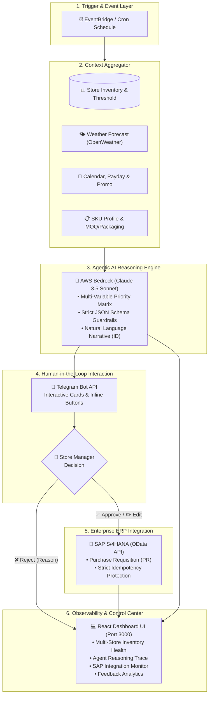

<div align="center">

# 📦 AutoReplenish.ai

### **Agentic AI for Minimarket Multi-Store Replenishment & Supply Chain Optimization**

*Mitigating Stockouts & Overstock with Context-Aware AI Reasoning, Human-in-the-Loop Telegram Interaction, and SAP S/4HANA Integration.*

[](https://python.org)
[](https://fastapi.tiangolo.com)
[](https://react.dev)
[](https://aws.amazon.com/bedrock/)
[](https://sap.com)
[](https://core.telegram.org/bots)
[](https://terraform.io)

</div>

---

## 🌟 Ringkasan Eksekutif (Executive Summary)

**AutoReplenish.ai** adalah platform orkestrasi rantai pasok cerdas (*Agentic AI*) berbasis *Human-in-the-Loop* yang dirancang khusus untuk jaringan minimarket ritel modern. 

Sistem ini menggantikan proses *restocking* manual yang lambat dan rentan bias dengan analisis prediktif multi-variabel otomatis. Menggunakan model AI canggih (**Claude 3.5 Sonnet via AWS Bedrock**), sistem mengevaluasi dinamika stok, cuaca lokal, kalender belanja, dan batasan operasional supplier sebelum mengajukan rekomendasi pemesanan langsung ke aplikasi Telegram Kepala Toko.

---

## 🎯 Masalah Bisnis & Solusi

| Tantangan Ritel Tradisional | Solusi AutoReplenish.ai |
| :--- | :--- |
| **Stockout (Kehabisan Stok):** Penjualan hilang karena pesanan terlambat atau tidak memperhitungkan *lead time* dan lonjakan promo. | **Proactive Replenishment:** Evaluasi berkala yang memprioritaskan SKU di bawah *safety threshold* dan memperhitungkan *burn rate* harian. |
| **Overstock & Waste:** Kerugian akibat produk *perishable* (makanan/roti/susu) kedaluwarsa karena memesan berlebih saat traffic toko sepi. | **Weather & Demographic Guardrails:** Penyesuaian kuota cerdas (contoh: memangkas pesanan perishable di area perkantoran saat akhir pekan & hujan lebat). |
| **Human Error & Latensi:** Kepala Toko membutuhkan waktu lama untuk menghitung pesanan dan menginput PR secara manual ke ERP. | **Interactive Telegram Bot:** Approval/Edit/Reject dengan 1-klik di Telegram yang otomatis menerbitkan Purchase Requisition ke SAP S/4HANA. |
| **Blackbox Decision:** Ketidakpercayaan manajer terhadap angka rekomendasi sistem otomatis. | **Explainable AI (XAI) & Audit Trail:** Setiap keputusan dilengkapi narasi penalaran Bahasa Indonesia dan jejak audit transparan di Dashboard. |

---

## 🏗️ Arsitektur Sistem



---

## 🧠 Matriks Bobot Penalaran Multi-Variabel

Agen AI mengevaluasi replenishment menggunakan bobot prioritas multi-faktor:

1. **Histori Penjualan & Level Stok (35% – 40%):** Membandingkan stok fisik vs ambang batas (*threshold*) dan laju konsumsi (*daily burn rate*).
2. **Jadwal Supplier & Lead Time (20% – 25%):** Mengantisipasi waktu tunggu pengiriman vendor (*lead time* 1–3 hari).
3. **Katalog Promosi Internal (15% – 20%):** Mendeteksi promo aktif (Beli 1 Gratis 1 / Diskon Gajian) untuk menaikkan kuota *buffer*.
4. **Kondisi Cuaca & Suhu (10% – 15%):** Mendeteksi hujan deras/ekstrem yang menurunkan kunjungan konsumen fisik.
5. **Kalender & Demografi Wilayah (5% – 10%):** Menyesuaikan tipe area toko (*Perkantoran vs Perumahan vs Kampus*) dan tipe hari (*Weekday vs Weekend*).
6. **Batasan Fisik Kemasan:** Penyesuaian otomatis terhadap kelipatan kemasan (*packaging multiple*) dan *Minimum Order Quantity (MOQ)*.

---

## 💻 Fitur Control Center Dashboard (React.js)

Dashboard kontrol web interaktif berjalan di `http://localhost:3000` dengan 4 modul utama:

| Modul | Deskripsi |
| :--- | :--- |
| 🏬 **Multi-Store Inventory Health** | Pemantauan stok real-time per cabang (Cabang Sudirman, Kemang, UI Depok) dengan indikator visual *Stockout Risk*, *Overstock Risk*, dan *Days of Supply*. |
| 🔍 **Agent Reasoning Trace** | Audit log transparansi penuh yang menampilkan input konteks, model version, skor kepercayaan (*confidence*), tingkat risiko, dan narasi penalaran AI. |
| ⚡ **SAP Integration Monitor** | Pemantauan koneksi OData API, SLA keberhasilan PR (> 99%), latensi server SAP, dan daftar transaksi PR *idempotent*. |
| 📊 **Feedback Analytics** | Analisis keputusan Kepala Toko (*Approval Rate*, *Rejection Rate*, *Edit Rate*) serta grafik alasan penolakan untuk *Continuous Learning*. |

---

## 📁 Struktur Direktori Repositori

```text
AutoReplenish.ai/
├── backend/                       # Source code backend production (AWS Lambda / Cloud)
│   ├── src/
│   │   ├── config.py              # Konfigurasi aplikasi & logging
│   │   ├── handlers/              # Lambda event handlers
│   │   ├── models/                # Pydantic data schemas
│   │   └── services/              # Bedrock, SAP, Weather, & DynamoDB services
│   └── requirements.txt
│
├── dashboard/                     # Web Control Center Dashboard (React + Vite)
│   ├── src/
│   │   ├── components/            # Reusable UI (Navbar, Sidebar, StatCard, RiskBadge, JsonModal)
│   │   ├── pages/                 # 4 Modul Dashboard
│   │   └── services/api.js        # Connector REST API
│   ├── package.json
│   └── vite.config.js
│
├── demo/                          # 🚀 100% Local Demo Environment (No Cloud / No AWS required)
│   ├── .env.example               # Template environment variables
│   ├── .env                       # Local active config
│   ├── db/
│   │   └── demo.db                # SQLite database (replaces DynamoDB)
│   ├── services/
│   │   ├── local_db.py            # SQLite database layer
│   │   ├── mock_bedrock.py        # Claude 3.5 Sonnet deterministic reasoning
│   │   ├── mock_sap.py            # Mock SAP S/4HANA PR generator & idempotency
│   │   ├── mock_weather.py        # Mock OpenWeatherMap per zone
│   │   └── telegram_bot.py        # Real Telegram Bot API client
│   ├── scripts/
│   │   ├── 00_check_setup.py      # Pre-flight diagnostic tool
│   │   ├── 01_init_db.py          # Create SQLite tables
│   │   ├── 02_seed_demo.py        # Seed 3 pilot stores, 4 SKUs, & inventory
│   │   ├── 03_run_pipeline.py     # Trigger AI orchestration pipeline
│   │   ├── 04_telegram_listener.py# Telegram interactive button callback listener
│   │   ├── 05_dashboard_api.py    # FastAPI local REST API (Port 8000)
│   │   └── 06_verify_sync.py      # Automated 4-layer synchronization test
│   └── README_DEMO.md             # Panduan lengkap presentasi demo lokal
│
├── infra/                         # Infrastructure as Code (Terraform)
│   ├── main.tf                    # AWS Lambda, DynamoDB, EventBridge, IAM definitions
│   └── variables.tf
│
├── tests/                         # Automated unit & integration test suite
└── README.md                      # Dokumentasi utama proyek
```

---

## 🚀 Panduan Menjalankan Demo Lokal (Quick Start)

Demo lokal ini dapat dijalankan **100% di komputer tanpa akun AWS dan tanpa kartu kredit**.

### 1. Prasyarat
* **Python 3.11+**
* **Node.js 18+**
* **Aplikasi Telegram** (Mobile atau Desktop)

---

### 2. Setup Konfigurasi `.env`

1. Buat bot baru di Telegram melalui **`@BotFather`** untuk mendapatkan `TELEGRAM_BOT_TOKEN`.
2. Dapatkan Chat ID akun Anda melalui **`@userinfobot`**.
3. Buka bot Anda di Telegram dan klik tombol **`START`**.
4. Buat file `demo/.env` (atau salin dari `demo/.env.example`):
   ```env
   TELEGRAM_BOT_TOKEN=token_bot_anda_dari_botfather
   TELEGRAM_CHAT_ID=chat_id_anda
   DEMO_MODE=local
   DASHBOARD_API_PORT=8000
   ```

---

### 3. Instalasi Dependensi

```bash
# 1. Install Backend Dependencies
cd demo
pip install -r requirements.txt

# 2. Install Frontend Dependencies
cd ../dashboard
npm install
```

---

### 4. Menjalankan Demo (4 Langkah Sederhana)

Buka terminal terpisah untuk menjalankan service:

#### **Terminal 1: Inisialisasi Database & Jalankan REST API**
```bash
cd demo
python scripts/01_init_db.py
python scripts/02_seed_demo.py
python scripts/05_dashboard_api.py
```
> *API aktif di `http://localhost:8000` (Swagger Docs: `http://localhost:8000/docs`)*

#### **Terminal 2: Jalankan Telegram Interactive Listener**
```bash
cd demo
python scripts/04_telegram_listener.py
```
> *Mendengarkan klik tombol Approve / Edit / Reject dari Telegram secara real-time.*

#### **Terminal 3: Jalankan React Dashboard UI**
```bash
cd dashboard
npm run dev
```
> *Buka browser di `http://localhost:3000`.*

#### **Terminal 4: Trigger Evaluasi AI Pipeline (Saat Demo/Presentasi)**
```bash
cd demo
python scripts/03_run_pipeline.py
```
> *Sistem langsung mengirimkan kartu rekomendasi interaktif ke aplikasi Telegram Anda.*

---

## 🧪 Validasi Sinkronisasi Otomatis

Untuk memastikan seluruh layer data (Telegram Listener ➔ SQLite ➔ FastAPI ➔ React UI) tersinkronisasi 100%, jalankan:

```bash
cd demo
python scripts/06_verify_sync.py
```

**Hasil Pengujian:**
```text
============================================================
🔍 AUTOREPLENISH.AI — Data Synchronization Verification
============================================================

Layer A: Telegram Listener → SQLite
[✅] APPROVE writes to SQLite correctly
[✅] EDIT writes to SQLite correctly
[✅] REJECT writes to SQLite correctly
[✅] Database path is consistent

Layer B: SQLite → Dashboard API
[✅] /audit-logs returns all records
[✅] /audit-logs/{id} returns full trace
[✅] /sap-monitor returns correct PR counts
[✅] /feedback-analytics returns correct stats
[✅] Database path is consistent

Layer C: Dashboard API → Dashboard UI
[✅] api.js points to http://localhost:8000
[✅] Mock fallback is disabled or explicit
[✅] Page components fetch from API (not hardcoded)
[✅] Field names match between API and components

Layer D: CORS and Connectivity
[✅] CORS is enabled
[✅] No port conflicts
[✅] No proxy misconfiguration

============================================================
RESULT: ALL PASSED
============================================================
```

---

## 🛡️ Keamanan & Kepatuhan Enterprise

* **No Hardcoded Secrets:** Seluruh kredensial dikelola melalui variabel *environment* `.env` (atau AWS Secrets Manager saat *production*).
* **Strict Idempotency Guard:** Mencegah penerbitan *Purchase Requisition* ganda di SAP saat terjadi *double-click* atau *network retry*.
* **Explainable AI (XAI):** Setiap rekomendasi AI memiliki riwayat jejak audit lengkap (*input payload*, *prompt version*, *reasoning text*, dan *timestamp*).

---

## 📄 Lisensi & Kontributor

Dikembangkan sebagai solusi **Agentic AI Supply Chain Optimization** untuk jaringan ritel modern.

* **Lisensi:** MIT License
* **Versi Prompt AI:** `v1.0`
* **Model AI Utama:** Anthropic Claude 3.5 Sonnet via AWS Bedrock
